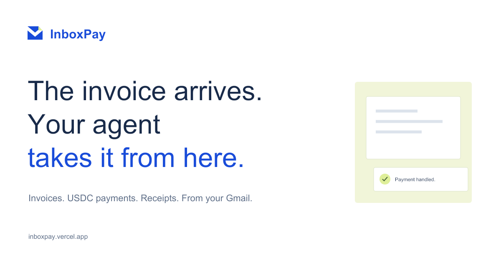

# InboxPay

**Payments, straight from your inbox.**

Connect the Gmail inbox where your business receives invoices. InboxPay finds invoice emails and supported PDFs, handles USDC payments, and keeps the payment record and receipt with each invoice. Review payments yourself or let your AP agent handle eligible invoices automatically within the settings you choose.



[Open InboxPay](https://inboxpay.vercel.app/) · [Watch the demo · 2:21](https://x.com/ShalyX_04/status/2111570265369104446) · [Business guide](https://inboxpay.vercel.app/help.html) · [Technical documentation](./docs/) · [Apache-2.0](./LICENSE)

## The business workflow

1. **Connect your invoice inbox.** Sign into InboxPay, name your business, and separately connect the Gmail account that receives invoices.
2. **See what needs paying.** The agent extracts the invoice details from email and text-based PDFs, checks the evidence, and explains anything that needs your attention.
3. **Pay from your business wallet.** Review an eligible payment or enable automatic payments using your verified vendors and payment settings. Each business has a dedicated Circle wallet for each enabled Arc environment.
4. **Keep the receipt.** InboxPay tracks the Circle submission, checks the Arc transaction, and records the reconciled payment against the invoice. Optional Telegram alerts keep you informed.

The aim is to remove the repeated work of copying vendor addresses, switching to a wallet, tracking a transfer, and matching its receipt back to an invoice.

## Recorded working proof

InboxPay was built during Tameion. The complete Gmail → automatic payment → reconciled receipt flow has been demonstrated on **Arc Testnet** in the builder-operated Caraxes Labs workspace. These are controlled integration tests, not independent customer traction or Mainnet invoice payments.

| Invoice | Amount | Recorded outcome | Arc Testnet receipt |
| --- | ---: | --- | --- |
| `AUTONOMY-TEST-002` | 0.10 USDC | One evaluation, queued job, execution attempt and Circle submission; confirmed payment and one reconciled receipt. | [Transaction](https://explorer.testnet.arc.io/tx/0x77f9bd481c33497a13c256198bea277f21cb3232c47b6cbf0f6fda2345369564) |
| `IP-ALERT-20261020-01` | 0.10 USDC | Automatic payment completed; the linked business Telegram chat received submitted and confirmed/reconciled alerts. | [Transaction](https://explorer.testnet.arc.io/tx/0x6e974d1fffa8c5e77baae429060d293e6e6cc59682d6e517353bac332598c592) |

The second invoice's replay checks found its payment ID already used, rejected onchain execution in a read-only simulation, and returned no database payment claim. The [recorded database replay workflow](https://github.com/ShalyX/inboxpay/actions/runs/39521638031) ran inside a rollback-only transaction. This was not another transfer or a full authenticated HTTP payment replay.

Public Testnet addresses for these controlled proofs:

- Dedicated business wallet: `0xca32c823b85c2b5de03c7626b42293b4fe18d5e2`
- Business policy vault: `0x59ceead805ef96fc2839388cafe937150412383a`

### Separate Mainnet evidence

The [recorded policy-vault deployment](./deployments/arc-mainnet-policy-vault.json) is at `0xa1dafca93784eeeecd081662435a5943eba73c66` on Arc Mainnet. A Circle developer-controlled wallet also completed a separate [0.001 USDC x402 purchase](https://explorer.arc.io/tx/0x0957a0febac2b4d5757148aa8e9d36861167ef4139c20bfd5105a4b404ac0186).

These demonstrate the Mainnet rail separately. A genuine external-vendor Mainnet invoice settlement is not claimed.

## How the payment flow works

```text
Gmail email / text PDF → invoice queue → payment decision
→ dedicated business wallet → Circle submission → Arc settlement → reconciled receipt
```

The current invoice parser and payment evaluator use deterministic rules; this repository does not claim an LLM performs the production decision. Decisions expose reasons to pay, wait, hold or request review. Eligible automatic payments enter a durable job queue; uncertain submissions are reconciled before a retry can proceed.

Gmail provides invoice evidence, Circle provides developer-controlled wallet and transaction services, and Arc provides USDC settlement. Supabase stores business records and execution state. Vercel hosts the static frontend and Node functions.

### Business separation and payment controls

Each business and Arc environment has its own wallet, vendor registry, payment settings, invoices and audit records. Switching Testnet/Mainnet changes the active context; it does not move funds. The application never substitutes a shared treasury wallet.

The **application** checks invoice evidence, required fields, sender verification, currency, business ownership, network and current payment readiness. The **business policy vault** enforces registered recipients, per-payment and daily limits, the owner wallet's cash floor, pause state and one-time payment IDs. These are different enforcement layers. Reconciliation matches the submitted payment to the Arc receipt before marking it confirmed.

See [architecture](./docs/ARCHITECTURE.md), [security](./docs/SECURITY.md) and the [operations runbook](./AUTONOMY-RUNBOOK.md) for the implementation and recovery procedures.

## Access and current limits

- InboxPay is in early access. Public Gmail OAuth verification is not complete; signing into the app does not guarantee an external account can connect Gmail.
- Email text and text-based PDF invoices are supported. Reliable OCR for scanned invoices is not implemented.
- The workspace currently supports an owner-operated business, not team roles or multi-person approvals.
- Full vendor onboarding and independent external-business acceptance remain unfinished.
- Mainnet financial writes require server enablement and explicit confirmation. Testnet receipts are not Mainnet customer usage.

Example payloads in [`examples/`](./examples/) are redacted reference shapes; they are not the hosted product's invoice source. Local visual fixtures are explicitly labelled and cannot exercise real integrations or payments.

## Run locally

Use Node.js 20 or newer. The application has no frontend compilation step.

```bash
npm ci
cp .env.example .env.local
```

Fill the required values using the [deployment guide](./docs/DEPLOYMENT.md), apply the committed [Supabase migrations](./supabase/migrations/) in filename order, and configure [authentication and Gmail](./GMAIL-SETUP.md). Then start the server with the private environment file:

```bash
node --env-file=.env.local dev-server.mjs
```

Open `http://localhost:3000`. Local APIs use the real handlers and still require provider configuration and authentication. Live Gmail consent requires a registered HTTPS callback; see the Gmail guide. Business users connect through OAuth and never provide client secrets or paste provider tokens.

Keep credentials, mailbox content, local invoice files and provider exports out of Git. Use separate Testnet and live Circle credentials; wallet and vault identities belong to the business/network records, not a global environment wallet ID.

## Documentation and license

[Documentation index](./docs/) · [API](./docs/API.md) · [Deployment](./docs/DEPLOYMENT.md) · [Backup and recovery](./docs/BACKUP-RECOVERY.md) · [Brand assets](./docs/BRAND.md)

InboxPay is licensed under [Apache License 2.0](./LICENSE).
