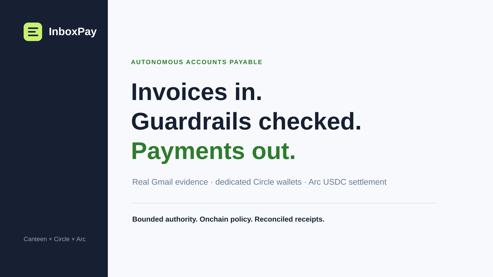

# InboxPay

InboxPay is an autonomous accounts-payable operator built for Tameion.



[Live product](https://inboxpay.vercel.app/) · [Submission materials](./docs/submission/) · [Operations runbook](./AUTONOMY-RUNBOOK.md) · [Apache-2.0 license](./LICENSE)

Each business gets its own InboxPay account, Gmail integration, AP policy, vendor registry, and isolated Circle developer-controlled wallet for each enabled Arc environment. The agent reads the business's real invoice inbox, makes a bounded payment decision, and can settle approved USDC invoices from that business wallet on Arc. Mainnet financial writes remain explicitly gated.

## The product

Gmail / PDF invoice
→ extraction
→ duplicate + currency + vendor checks
→ agent decision
→ policy vault
→ Circle transaction signing
→ Arc USDC settlement
→ reconciliation + receipt

The key design choice is that the model does not get to invent its own spending authority. The execution path is bounded by a smart-contract vault with vendor allowlisting, per-transaction limits, daily limits, a cash floor, pause control, and onchain duplicate-payment protection.

## Local setup

Use Node.js 20+.

Install dependencies:

```bash
npm install
```

Authenticate the Canteen Arc CLI and export the unique Canteen RPC:

```bash
uv tool install arc-canteen
arc-canteen login
arc-canteen rpc-url --export
```

The app expects the resulting RPC as ARC_RPC_URL or the exported RPC value.

Circle credentials are read from the existing local environment. Production uses separate Testnet and live Circle credentials plus the Arc RPC settings. Wallet IDs, wallet addresses, and policy-vault addresses are created and persisted per business and network; do not configure a shared runtime wallet or treasury address.

### Gmail integration

Users do not enter Gmail client IDs, client secrets, or refresh tokens. After signing into InboxPay, they click **Connect Gmail** and complete a Google OAuth consent flow for the Gmail account that actually carries the business's invoices.

The OAuth callback binds the Google connection to the authenticated InboxPay user, encrypts the provider tokens before persistence, and stores only the minimum integration metadata in Supabase. Invoice bodies and PDF contents are never written to Git.

Google refresh tokens are used only server-side to refresh short-lived access tokens when InboxPay syncs the user's inbox.

### Local Gmail scanning

```bash
npm run scan:gmail
npm run evaluate
```

Start the product:

```bash
npm start
```

Then open http://localhost:3000.

## Multi-business, multi-network execution

Every business owns separate Arc Testnet and Arc Mainnet account contexts. Each context has its own Circle wallet, policy vault, vendor registry, invoices, scheduling state, and audit trail. The product's environment selector changes which isolated account is active; switching environments does not move funds or submit a transaction. The agent never selects a global treasury wallet at runtime.

The execution route refuses invoices unless the evaluator has marked them PAY_NOW, the currency is USDC, the business is not paused, the vendor is verified, the payment is inside the business's per-transaction and daily limits, and the business wallet remains above its configured cash floor.

Before settlement, the contract is checked for:
- duplicate payment ID
- vendor recipient
- vault balance + cash floor
- per-transaction limit
- daily spending limit
- paused state

The payment receipt is reconciled against the vendor balance after the Arc transaction confirms.

## Authentication and Google setup

InboxPay uses Supabase Auth for business account authentication. Email/password signup and Google sign-in both land on the production Vercel origin. The hosted Supabase project must have Google enabled with a **Web application** OAuth client.

Configure the production Supabase URL settings with:

`https://tameion-ap-agent-live.vercel.app/`

In Google Cloud, the Web OAuth client should authorize the production origin:

`https://tameion-ap-agent-live.vercel.app`

and the Supabase Auth callback:

`https://ecportgmionyhlofyobc.supabase.co/auth/v1/callback`

The Gmail connector is a separate Google OAuth flow. Its callback is:

`https://tameion-ap-agent-live.vercel.app/api/gmail/callback`

## Deployment

This repo is intentionally framework-light: static HTML/CSS/JS in `public/` plus native Vercel Node functions under `api/`. There is no frontend build step. `dev-server.mjs` is for local development only, but it dispatches to the same production-shaped API handlers rather than a mock invoice/payment layer; local API calls still require the configured environment and an authenticated session. Production traffic goes directly to the Vercel functions. The canonical public product URL is [inboxpay.vercel.app](https://inboxpay.vercel.app/); the longer Vercel project alias remains in use for registered OAuth callbacks.

Set the infrastructure secrets in Vercel, including Circle credentials, Supabase configuration, Gmail OAuth client credentials, and token-encryption secrets. Users supply their own OAuth consent through the product; they never configure infrastructure secrets.

The bounded-autonomy worker and business-wallet withdrawals additionally require the server-only `SUPABASE_SECRET_KEY`, `AUTONOMY_CRON_SECRET`, and `supabase/migrations/20261015_autonomy_and_withdrawals.sql`. The worker is invoked through the existing invoices function so the production build remains at 12 Vercel functions. Follow [AUTONOMY-RUNBOOK.md](./AUTONOMY-RUNBOOK.md) for the Supabase Cron trigger, Testnet proof, monitoring, recovery, and Mainnet release gate.

The authenticated **Operations** page uses the existing activity function to show fresh, read-only Gmail, Circle, Arc RPC, Supabase, and reconciliation health for the active business and network. It also exposes durable retry and operator-review states without triggering a financial write. This keeps the Vercel deployment at 12 functions and preserves the same per-business authorization boundary.

Do not commit Gmail tokens, Circle wallet exports, OAuth credentials, local invoice files, or evaluator output.

## Hackathon proof

The project includes a real Gmail-derived evaluator, email and PDF evidence ingestion, dedicated Circle developer-controlled wallets, onchain payment policy enforcement, durable autonomous execution, reconciliation, a live x402 purchase on Arc Mainnet, and an Arc Mainnet PaymentPolicyVault deployment. Private Gmail/OAuth/Circle artifacts stay local; `demo-decisions.json` is the redacted reviewer-facing sample.

The complete autonomous AP proof is on **Arc Testnet**. Invoice `AUTONOMY-TEST-002` settled exactly once for `0.10 USDC` from the dedicated Caraxes Labs wallet and reconciled in InboxPay. Its transaction is `0x77f9bd481c33497a13c256198bea277f21cb3232c47b6cbf0f6fda2345369564`.

## Arc mainnet proof

The production PaymentPolicyVault is deployed on Arc Mainnet at `0xa1dafca93784eeeecd081662435a5943eba73c66`.

InboxPay also completed a real x402 purchase on Arc Mainnet through Circle's developer-controlled wallet. The 0.001 USDC settlement transaction is `0x0957a0febac2b4d5757148aa8e9d36861167ef4139c20bfd5105a4b404ac0186`.

The Mainnet policy deployment and x402 purchase prove the live Arc/Circle rail separately; they are not presented as a Mainnet invoice settlement. A genuine third-party vendor Mainnet AP payment remains a release gate.

Tameion final submission requires a public GitHub repository and a recorded demo under three minutes. A live product URL is encouraged.

Submission copy, the demo script, QA status, and visual assets live in [`docs/submission`](./docs/submission/).


## Agent handoff

For continuing development in Codex or another coding agent, read **[AGENTHANDOFF.md](./AGENTHANDOFF.md)** before making changes. It records the current architecture, live infrastructure, production OAuth setup, known blockers, verification status, and the immediate execution queue.

## License

InboxPay is licensed under the [Apache License 2.0](./LICENSE).

## Product onboarding

1. A business creates or signs into an InboxPay account.
2. The business selects Arc Testnet or Arc Mainnet, then explicitly provisions the dedicated Circle developer-controlled wallet for that environment. Entering Mainnet and creating its wallet both require explicit confirmation.
3. The business connects the Gmail account used for invoices through the InboxPay OAuth flow.
4. The business registers vendor settlement addresses and configures AP limits.
5. The business deploys and funds the policy guard required for autonomous settlement.
6. InboxPay continuously evaluates real invoice evidence and settles approved USDC payments from that business wallet.

The hackathon evaluates genuine business usage and real USDC activity during the event window, so the production path intentionally requires a real connected business inbox rather than a synthetic invoice dataset.
