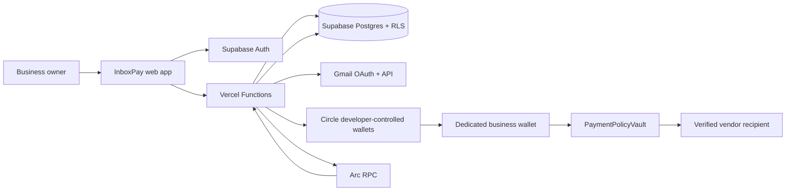

# Architecture

## Purpose

InboxPay turns invoice evidence from a business Gmail account into a bounded payment decision and, when every control passes, a reconciled USDC settlement on Arc. Each business and Arc environment has its own Circle developer-controlled wallet, policy state, vendor registry, invoice set, and audit history. There is no shared treasury wallet.

## System map

## Runtime components

| Area | Implementation | Responsibility |
| --- | --- | --- |
| Browser | `public/index.html`, `public/inboxpay.js`, `public/ui-state.mjs` | Authentication, business/network selection, invoice review, policy/vendor controls, payment confirmation, business activity and notification connection. |
| API | `api/*.mjs` | Authenticated orchestration. No browser receives Circle, Gmail, encryption, worker, or Supabase server secrets. |
| Domain logic | `lib/*.mjs` | Invoice evaluation, Gmail/PDF parsing, wallet provisioning, policy synchronization, preflight, payment execution, scheduling, autonomy, reconciliation, and recovery. |
| Durable state | Supabase Postgres | Business ownership, isolated network accounts, vendors, policies, integrations, invoices, audit events, execution jobs, and withdrawals. RLS scopes authenticated reads and writes. |
| Custody | Circle Developer-Controlled Wallets | One wallet per business and Arc environment. Circle signs submissions; wallet IDs and addresses are persisted against the isolated network account. |
| Settlement | Arc Testnet / Arc Mainnet | USDC transfers execute through the business policy contract and are accepted only after receipt and event reconciliation. |
| Policy | `contracts/BusinessPolicyVault.sol` | Registered vendor recipient, per-payment limit, daily limit, cash floor, pause state, and duplicate payment ID. |
| Worker | `lib/autonomy.mjs` through `POST /api/invoices` | Claims durable jobs, re-runs all live gates, submits at most one payment attempt, and reconciles uncertain outcomes. |
| Notifications | `api/activity.mjs`, `api/config.mjs`, `lib/*notifications*.mjs` | Links one encrypted Telegram destination per business with a short-lived code. Customer delivery is limited to connection tests; provider incidents use the operator alert path. |

## Invoice and payment lifecycle

1. The authenticated business connects Gmail through the hosted OAuth flow.
2. InboxPay discovers bounded invoice candidates and parses email and text-based PDF evidence.
3. Records from the same Gmail message, invoice number, and sender identity are merged. Conflicting explicit vendor identities escalate.
4. The evaluator produces `PAY_NOW`, `HOLD`, `ESCALATE`, or `SCHEDULE` with stored reasons.
5. Server preflight verifies the active business/network, decision, USDC currency, vendor and sender identity, recipient, wallet, allowance, limits, cash floor, pause state, duplicate state, and live contract result.
6. The owner explicitly confirms a manual payment, or a previously enabled bounded-autonomy job reaches its execution time.
7. Circle submits the transaction from that business's dedicated wallet.
8. InboxPay stores the Circle transaction ID before the result is treated as final.
9. Reconciliation verifies the Arc receipt, policy contract, payment event, recipient, amount, and one-time payment ID.
10. Only matching evidence produces a confirmed invoice and reconciled receipt. Uncertain outcomes remain recoverable and are not blindly resubmitted.

## Decision boundary versus security boundary

The agent classifies invoice evidence and proposes an action. It is not the security boundary.

Application preflight enforces identity, evidence completeness, currency, active business/network, wallet readiness, allowance readiness, settlement state, recipient matching, and live provider availability. The policy contract independently enforces the registered recipient, per-payment and daily limits, cash floor, pause state, and duplicate payment ID onchain.

## Network isolation

`ARC-TESTNET` and `ARC` are separate account contexts. Switching the visible environment does not move funds. Every mutating request includes the expected network, and the server rejects stale or cross-network requests. Mainnet wallet creation, policy changes, vendor-policy changes, withdrawals, and payments require explicit Mainnet confirmation. Server-side Mainnet writes are also gated by `INBOXPAY_ALLOW_MAINNET_WRITES=true`.

## Failure and recovery model

- Provider timeouts do not prove failure.
- Circle transaction IDs and deterministic idempotency keys are stored before retry decisions.
- Processing, retry, and reconciling states preserve the original attempt.
- The operator worker performs read-only Gmail, Circle, Arc RPC, Supabase, and reconciliation checks, persists state, and pages the operator destination. Internal diagnostics are not exposed through the business app.
- Emergency control is layered: disable autonomy, pause the policy, revoke allowance, then stop the global scheduler if every business must stop.

See [SECURITY.md](./SECURITY.md) and [the operations runbook](../AUTONOMY-RUNBOOK.md) for the detailed boundaries.
